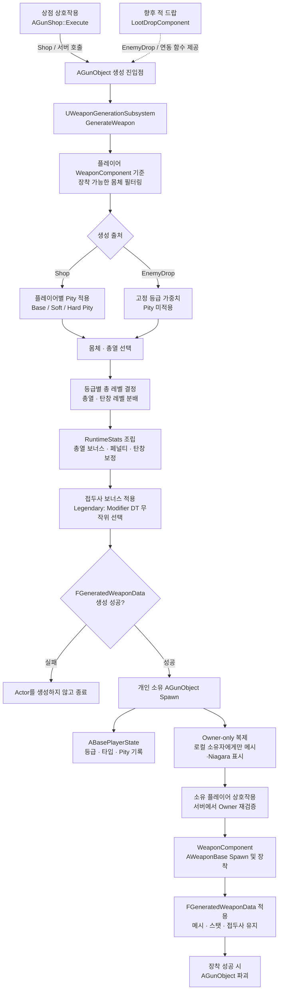

# #27 PCG 무기 파츠 시스템 구현

## Issue

- Issue 번호: #27
- 기능명: PCG 무기 파츠 시스템 구현
- 담당 영역: Weapon Generation / Parts / Reward / Replication
- 관련 의존성: #16 공통 무기 베이스 구현
- 연관 이슈: #28 무기 등급 및 가챠 확률, #29 무기 가챠 천장 시스템, #30 무기 드랍 및 장착 교체

## 목적

몸체와 총열 조합, 파츠 레벨, 접두사 보너스로 런타임 무기 성능을 생성한다.

탄창은 별도 파츠나 메시로 생성하지 않고 몸체의 기본 탄창 용량과 탄창 레벨로 최종 용량을 계산한다. 기존 제조사별 공격 형태는 접두사 보너스로 대체하며, 최초 접두사 효과로 스마트 트래킹을 지원한다.

멀티플레이에서는 서버만 생성 결과를 확정하고, 상점에서 생성된 개인 무기는 해당 플레이어에게만 표시되고 장착되도록 구성한다.

## 주요 구조



생성 계산과 월드 액터를 분리했다. `UWeaponGenerationSubsystem`이 완전한 생성 결과를 먼저 만든 뒤 성공한 경우에만 `AGunObject`를 Spawn하므로, 잘못된 데이터나 장착 가능한 몸체가 없는 경우 빈 액터가 월드에 생성되지 않는다.

## 구현 파일

### 생성 정책과 데이터

- `Source/TeamProject_Fin/GameCore/Weapon/Generation/WeaponGenerationSubsystem.h`
- `Source/TeamProject_Fin/GameCore/Weapon/Generation/WeaponGenerationSubsystem.cpp`
- `Source/TeamProject_Fin/GameCore/Weapon/Generation/WeaponGenerationTypes.h`
- `Source/TeamProject_Fin/GameCore/Weapon/Data/WeaponTypes.h`

### 월드 생성과 상점

- `Source/TeamProject_Fin/GameCore/Weapon/World/GunObject.h`
- `Source/TeamProject_Fin/GameCore/Weapon/World/GunObject.cpp`
- `Source/TeamProject_Fin/GameCore/Weapon/World/GunShop.h`
- `Source/TeamProject_Fin/GameCore/Weapon/World/GunShop.cpp`
- `Source/TeamProject_Fin/GameCore/Weapon/World/GunObjectVisualComponent.h`
- `Source/TeamProject_Fin/GameCore/Weapon/World/GunObjectVisualComponent.cpp`

### 생성 무기 장착과 복제

- `Source/TeamProject_Fin/GameCore/Weapon/Core/WeaponBase.h`
- `Source/TeamProject_Fin/GameCore/Weapon/Core/WeaponBase.cpp`
- `Source/TeamProject_Fin/GameCore/Weapon/Core/WeaponComponent.h`
- `Source/TeamProject_Fin/GameCore/Weapon/Core/WeaponComponent.cpp`

### 플레이어별 생성 기록

- `Source/TeamProject_Fin/GameCore/BasePlayerState.h`
- `Source/TeamProject_Fin/GameCore/BasePlayerState.cpp`

## 생성 결과 데이터

`FGeneratedWeaponData`는 월드 픽업과 장착된 무기가 공유하는 무기 인스턴스 결과다.

| 필드 | 용도 |
|---|---|
| `WeaponCategory` | Rifle, GrenadeLauncher, SniperRifle 장착 분류 |
| `Rarity` | Common, Uncommon, Epic, Legendary 등급 |
| `GenerationSource` | Shop 또는 EnemyDrop 생성 출처 |
| `BarrelLevel` | 총열 보너스 및 페널티 배율 계산 |
| `MagazineLevel` | 몸체 기본 탄창 용량 보정 |
| `FrameName`, `BarrelName` | 생성 파츠 식별과 무기 이름 구성 |
| `RuntimeStats` | 최종 피해량, 발사 간격, 탄창 용량, 사거리 및 접두사 효과 |
| `FrameMesh`, `BarrelMesh` | 픽업 및 장착 무기의 조립 메시 |
| `BarrelSocketName`, `BarrelRelativeTransform` | 총열 부착 위치 |

정적 발사 동작과 공용 설정은 기존 `UWeaponDataAsset` 템플릿을 사용하고, 인스턴스마다 달라지는 결과만 `FGeneratedWeaponData`로 복제한다. 기존 `FGunObjectStatComponent`의 중복 상태는 제거했다.

## 파츠 생성 규칙

### 몸체

몸체 행은 기본 스탯, 메시, 무기 카테고리를 가진다. 생성 대상 플레이어의 `UWeaponComponent::AllowedWeaponCategories`를 기준으로 장착 가능한 몸체만 후보에 포함한다.

예를 들어 Bruiser가 Rifle만 허용한다면 상점 생성 결과에 GrenadeLauncher 또는 SniperRifle 몸체가 포함되지 않는다.

### 총열

총열 행은 다음 효과를 가진다.

- 기본 보너스
- 보조 보너스
- 페널티

각 효과는 총열 레벨에 따라 Damage, FireInterval, ReloadTime, MagazineSize, Range 중 하나를 보정한다. 최종 수치는 `FWeaponRuntimeStats::Sanitize()`로 유효 범위에 정리한다.

### 탄창 레벨

탄창은 별도의 파츠 데이터나 메시를 사용하지 않는다.

```text
최종 탄창 용량 = 몸체 기본 탄창 용량 × (1 + 탄창 레벨 × 0.2)
```

등급에 따라 총 파츠 레벨 범위를 먼저 결정한 뒤 총열과 탄창 레벨로 분배한다.

| 등급 | 총 레벨 범위 |
|---|---:|
| Common | 3~5 |
| Uncommon | 5~7 |
| Epic | 7~10 |
| Legendary | 7~10 |

총열 레벨과 탄창 레벨은 각각 1~5 범위로 제한한다.

## 접두사 보너스

제조사 개념 대신 `FGunModifierRow`의 `Modifier`와 `PrefixName`으로 접두사를 결정한다.

Legendary 무기는 ModifierTable의 전체 행에서 동일 확률로 하나 선택한다. 선택한 행의 Modifier를 추가하고 PrefixName으로 다음 형식의 무기 이름을 만든다. 프레임에서 복사된 Modifiers는 비우고 DT_Modifier에서 선택한 효과만 적용한다. Legendary가 아니거나 테이블이 없거나 비어 있으면 모디파이어를 부여하지 않는다.

```text
접두사 있음: [접두사] [총열] [몸체]
접두사 없음: [총열] [몸체]
```

스마트 트래킹의 실제 발사 동작은 기존 무기 Modifier 경로를 재사용한다. 추가 접두사 효과는 후속 이슈에서 `FGunModifierRow`와 Modifier 처리 경로를 확장한다.

## 생성 출처와 확률

### 상점

`AGunShop::Execute()`는 서버에서 상호작용한 플레이어를 전달하여 `SpawnRandomShopWeapon()`을 호출한다.

상점은 플레이어별 천장 상태를 적용한다. 기본값은 다음과 같으며 `FWeaponPitySettings`를 통해 런타임에 조정할 수 있다.

| 항목 | 기본값 |
|---|---:|
| Legendary 기본 확률 | 0.6% |
| Legendary Soft Pity 시작 | 74회 |
| Soft Pity 회당 증가량 | 6%p |
| Legendary Hard Pity | 90회 |
| Epic 이상 기본 확률 | 5.1% |
| Epic 이상 Hard Pity | 10회 |

`SetShopPitySettings()`으로 서버 실행 중 값을 교체할 수 있다. Common과 Uncommon은 `ShopLowRarityWeights`의 가중치로 결정한다.

### 적 드랍

적 드랍 시스템 자체는 이번 구현 범위에 포함하지 않는다. 향후 `LootDropComponent`가 직접 연결할 수 있도록 서버 함수만 제공한다.

```cpp
AGunObject::SpawnRandomEnemyDrop(
    WorldContextObject,
    EligiblePlayer,
    SpawnTransform,
    GunObjectClass);
```

적 드랍은 상점 천장을 사용하지 않고 `EnemyDropRarityWeights`의 고정 등급 가중치를 사용한다. 기본 가중치는 Common 60, Uncommon 30, Epic 9, Legendary 1이다.

## 플레이어별 기록과 천장 상태

`ABasePlayerState`는 서버에서 생성 성공이 확정된 뒤 다음 정보를 플레이어별로 기록한다.

- 전체 생성 횟수
- 등급별 누적 생성 횟수
- 무기 카테고리별 누적 생성 횟수
- 최근 생성 기록 100개
- 상점 Legendary 이후 뽑기 횟수
- 상점 Epic 이상 이후 뽑기 횟수

최근 기록과 누적 카운터를 분리해 기록 배열이 무한히 커지지 않도록 했다. 상점 천장 카운터는 상점 생성에만 갱신되며 적 드랍 결과는 천장에 영향을 주지 않는다.

## 서버 권한과 개인 픽업 표시

생성, 확률 판정, 기록 갱신, 장착 및 액터 파괴는 서버에서만 수행한다.

`AGunObject`는 생성 대상 `APlayerController`를 Owner로 지정하고 `bOnlyRelevantToOwner`를 사용한다. 원격 클라이언트에는 소유한 개인 픽업만 복제된다.

리슨 서버의 권한 월드에는 모든 서버 액터가 존재하므로 네트워크 relevancy만으로는 원격 클라이언트의 픽업 메시가 숨겨지지 않는다. 이를 보완하기 위해 `RefreshLocalVisibility()`가 Owner 컨트롤러의 `IsLocalController()`를 확인하고, 로컬 소유자 화면에서만 몸체·총열 메시와 희귀도 Niagara를 표시한다.

상호작용 시에도 전달된 PlayerController와 Actor Owner가 같은지 다시 검증한다. 따라서 다른 플레이어는 개인 픽업을 보거나 장착할 수 없다.

## 테스트 및 확인 내용

- [x] 몸체와 총열 조합으로 무기 기본 스탯 결정
- [x] 총열 및 탄창 레벨에 따른 성능 계산
- [x] 접두사 보너스를 RuntimeStats와 무기 이름에 적용
- [x] Legendary 생성 무기에 스마트 트래킹 접두사 적용
- [x] 서버 권한 생성 및 생성 실패 시 Actor Spawn 방지
- [x] 플레이어 장착 가능 카테고리 기반 상점 생성
- [x] 상점 전용 천장과 적 드랍 고정 확률 분리
- [x] 플레이어별 등급·카테고리·최근 생성 기록 저장

## 남은 작업 및 확장 방향

- `LootDropComponent` 완료 후 `SpawnRandomEnemyDrop()` 연결
- 스마트 트래킹 외 추가 접두사 효과 구현
- 상점 가격, 구매 비용 및 생성 UI 연동
- 생성 무기의 등급, 파츠 레벨 및 접두사를 HUD에 표시