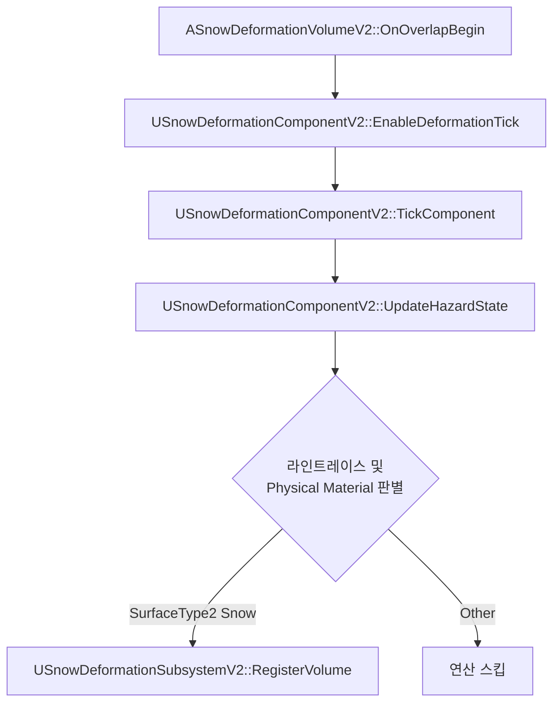
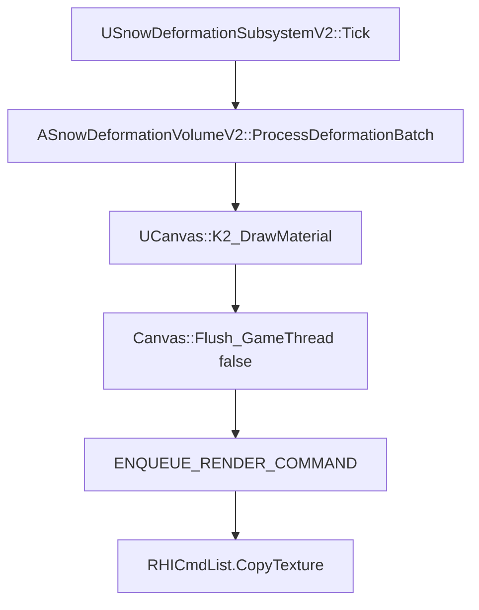
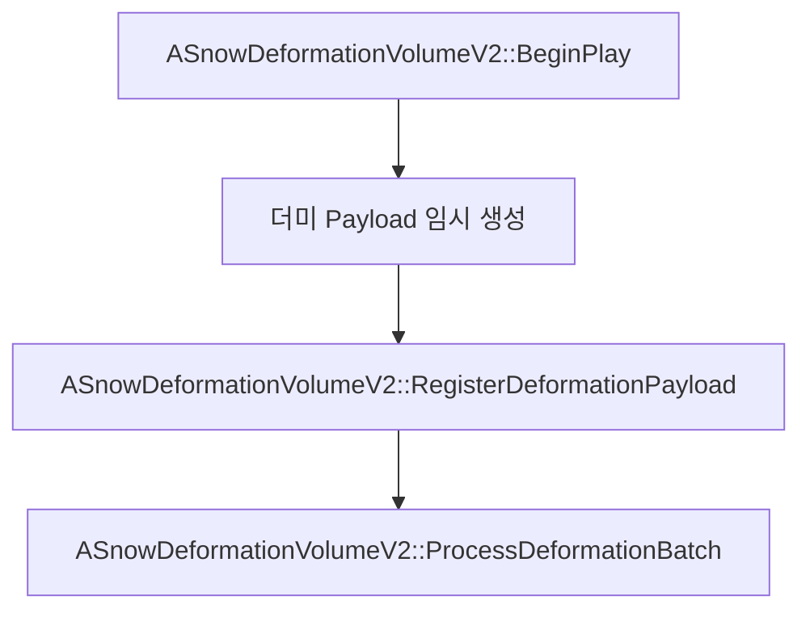

# Issue #90 Snow Deformation V2 (눈 변형 시스템 업그레이드)

## 1. Issue
- **Issue 번호**: #90
- **기능명**: Snow Deformation V2 (눈 파임 시스템 고도화 및 최적화)
- **담당자**: seok0317
- **담당 영역**: Environment / Rendering / Collision / Optimization

## 2. 목적
기존 눈 변형 시스템(V1)에서 발생하던 심각한 프레임 하락(렌더 스레드 병목)과 나나이트 테셀레이션의 성능 한계를 극복하고, 라인트레이스를 통한 정밀한 발자국 물리 연산을 구현하여 고품질/고효율의 눈밭 상호작용 아키텍처를 구축한다.

## 3. 주요 구조
- **라인트레이스 감지 구조**: 캡슐 오버랩이 아닌 매 프레임 캐릭터 발밑으로 Raycast를 쏘아 바닥의 `Physical Material`을 판별하는 물리 의존적 구조.
- **틱(Tick) 토글 및 캐싱 구조**: 볼륨(BoundsBox) 진입 시에만 연산 틱을 활성화하고, 이탈 시 캐시된 위치 데이터와 디버프 태그를 날려버리는 무동력 최적화 구조.
- **렌더타겟 핑퐁 비동기 구조**: `ProcessDeformationBatch`에서 UCanvas 명령을 모아 실행하되, `Flush_GameThread(false)`를 통해 GPU 렌더링을 비동기로 위임하는 병렬 처리 구조.

## 4. 관련 구현 파일
- **C++ Classes**:
  - `SnowDeformationVolumeV2.h / .cpp`: 렌더타겟 핑퐁 메모리 소유, 비동기 렌더링 배치 처리, 바운드 박스 오버랩 감지, 워밍업 스폰.
  - `SnowDeformationComponentV2.h / .cpp`: 캐릭터 발에 부착되어 라인트레이스를 쏘고 위치(Payload)를 기록하며, 볼륨 진입 시 틱 토글 스위칭 담당.
  - `SnowDeformationSubsystemV2.h / .cpp`: 맵에 존재하는 모든 눈 볼륨을 전역에서 관리하며 발자국 렌더링 호출 및 이동속도 디버프 분배.
- **Data / Materials**:
  - `DefaultEngine.ini`: 물리 머티리얼 속성 추가 (`SurfaceType2 = Snow`).
  - `M_SnowBrush_V2`: 발자국 렌더타겟 브러시 머티리얼.
  - `M_Snow_Displacement`: 나나이트 테셀레이션 파임 효과 및 원거리 렌더링 감쇠(PixelDepth) 셰이더.

## 5. 주요 구현 내용 및 시스템 역할

### 5.1 상호작용 감지 및 틱(Tick) 제어 파이프라인
캐릭터가 눈밭 밖에서는 연산을 끄고, 진입 시에만 틱을 활성화하여 라인트레이스로 바닥을 스캔하는 플로우입니다.

#### 동작 플로우 및 함수 명세

- **`ASnowDeformationVolumeV2::OnOverlapBegin` (`SnowDeformationVolumeV2.cpp`)**: 캡슐이 닿으면 컴포넌트의 틱을 켬.
- **`USnowDeformationComponentV2::EnableDeformationTick` (`SnowDeformationComponentV2.cpp`)**: 진입/이탈 여부에 따라 틱 연산 강제 토글 (잉여 비용 0% 달성).
- **`USnowDeformationComponentV2::UpdateHazardState` (`SnowDeformationComponentV2.cpp`)**: 수직 `LineTrace`를 발사하고 물리 머티리얼(PM)이 `Snow`일 때만 눈 밟음 판정.

### 5.2 비동기 렌더링 및 핑퐁 복사 파이프라인
서브시스템에 등록된 발자국 위치를 렌더 타겟에 그리고 메모리를 스왑하는 과정입니다.

#### 동작 플로우 및 함수 명세

- **`USnowDeformationSubsystemV2::Tick` (`SnowDeformationSubsystemV2.cpp`)**: 렌더링 배치 업데이트 일괄 호출.
- **`ASnowDeformationVolumeV2::ProcessDeformationBatch` (`SnowDeformationVolumeV2.cpp`)**: Payload를 UV 좌표로 변환, `K2_DrawMaterial` 로 붓질 후 핑퐁 스왑 수행.
- **`Canvas::Flush_GameThread` (엔진 코어)**: `false`를 통해 GPU 비동기 위임 (게임 스레드 Block 방지).
- **`ENQUEUE_RENDER_COMMAND` (엔진 코어 매크로)**: 게임 스레드(캐릭터 로직 및 연산)와 렌더 스레드(VRAM 제어 및 렌더링)의 역할을 엄격히 분리합니다. 게임 스레드가 계산한 발자국 연산 결과와 렌더 타겟 주소를 캡슐화하여 렌더 스레드의 큐(Queue)에 안전하게 전달함으로써, 메인 스레드 크래시 없이 비동기 렌더링이 이루어지게 합니다.

### 5.3 렌더 스레드 워밍업 파이프라인
최초 눈밭 진입 시 GPU 셰이더 초기화 지연(Hitch)을 막는 플로우입니다.

#### 동작 플로우 및 함수 명세

- **`ASnowDeformationVolumeV2::BeginPlay` (`SnowDeformationVolumeV2.cpp`)**: 생성 시 눈에 안 보이는 더미 발자국을 즉시 그려서 GPU 캐싱 사전 완료.

## 6. 트러블슈팅 및 픽스 내역

### 트러블슈팅 1: 오버랩 기반 감지의 허공 발자국 오류
- **문제**: 기존 V1은 박스에 오버랩만 되면 허공에서 뛰어도 발자국이 남는 치명적 물리 오류 발생.
- **해결**: 오버랩은 틱 활성화 스위치로만 쓰고, 실제 발자국은 라인트레이스가 반환하는 `Physical Material`이 정확히 `SurfaceType2(Snow)`일 때만 찍히도록 필터링.

### 트러블슈팅 2: 메쉬 자동 맞춤 기능의 한계와 UV 왜곡
- **문제**: 볼륨을 직사각형으로 길게 늘릴 시 메쉬 스케일 왜곡으로 인해 발자국 렌더타겟이 타원형으로 찌그러지는 부작용 발생.
- **해결**: 복잡한 UV 픽스 오버엔지니어링 대신 기존 비례 공식을 살림. 맵 배치 시 크기 보정을 위해 메쉬 크기 자동화 플래그(`bAutoFitBoundsToMesh`)를 꺼서 수동 오버라이드할 수 있도록 유연성 부여.

### 트러블슈팅 3: 동기화 락(Lock)에 의한 프레임 폭락
- **문제**: 발자국이 찍힐 때마다 프레임이 10단위로 폭락하는 치명적 렉 발생.
- **해결**: `DrawCanvas.Flush_GameThread(true)`가 게임 스레드를 Block 시키고 있었음을 파악하여 `false` 파라미터(비동기 렌더링)로 교체해 프레임 완전 회복.

### 트러블슈팅 4: 첫 렌더링 초기화 지연 (Hitch)
- **문제**: 첫 발자국이 찍힐 찰나에만 미세한 렉이 발생.
- **해결**: `BeginPlay` 에서 초소형 가짜 발자국을 즉시 한 바퀴 그려내어 GPU 셰이더와 메모리 할당을 로딩 단계에서 사전 캐싱시키는 워밍업(Warm-up) 도입.

### 트러블슈팅 5: 나나이트 테셀레이션 광역 GPU 과부하
- **문제**: 화면 전체 눈밭을 픽셀 단위로 쪼개느라 막대한 GPU 오버헤드 발생.
- **해결**: 머티리얼 내부에 `PixelDepth`와 `SmoothStep`을 활용, 카메라 반경 15m 내외만 파임 연산을 적용하고 멀어지면 상수값으로 보간하여 나나이트 연산 대거 스킵. (역방향 입력에 따른 원거리 증발 에러는 `OneMinus`를 통해 해결함).

## 7. 사용 방법
1. **레벨 배치**: 에디터에 `BP_SnowDeformationVolumeV2`를 배치.
2. **크기 조절**: `BoundsBox`를 늘려 영역 세팅 (기본: 메쉬 자동 스케일). 비율 조정이 필요하면 `bAutoFitBoundsToMesh`를 끄고 수동 세팅.
3. **PM 지정**: 눈밭 위에 장애물 배치 시, 구조물의 Collision PM이 `Snow`로 오할당되지 않도록 주의(허공 발자국 원인).

## 8. 테스트 또는 확인 내용
- **물리 검증**: 눈밭 위에 올려진 바위(Default PM)로 점프 착지 시, 눈자국 렌더링이 되지 않는 현상 디버깅 완료.
- **비동기 퍼포먼스**: 볼륨 내 다중 캐릭터가 움직일 때 메인 게임 스레드 드랍 현상 없이 부드러운 프레임 60+ 방어 확인 완료.
- **셰이더 지연 검증**: 첫 진입 시 프레임 스파이크 발생률 0% 테스트 완료.

## 9. 남은 작업 또는 확장 방향
- **VHM 확장**: 맵 크기가 수 킬로미터 이상의 오픈월드로 확장될 경우, 볼륨마다 RT를 개별 소유하는 현재 시스템을 버리고 단일 RVT 기반 Virtual Heightfield Mesh로 렌더링 플랫폼 전환 고려.
